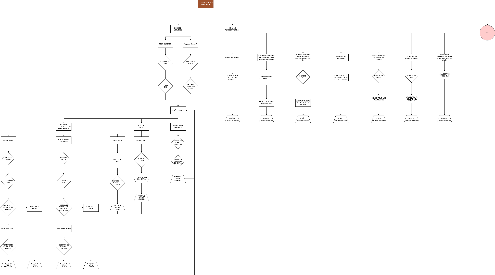

<h1 align="center">🚌 SUBEMISIONERO</h1>
<h3 align="center">Sistema de Gestión de Transporte Urbano</h3>

<p align="center">
  
  
  
  
</p>

Trabajo Práctico Integrador desarrollado en **lenguaje C** para la cátedra de **Programación Estructurada** (1.° año de Ingeniería en Informática, UGD).

El sistema simula la operatoria de la tarjeta SUBE y una billetera electrónica en el área metropolitana de **Posadas, Garupá y Candelaria (Misiones)**. Incluye validación de beneficios sociales, recarga de saldo con emisión de comprobantes y un panel administrativo con estadísticas y auditoría.

---

## 📑 Índice

- [Contexto y créditos](#-contexto-del-proyecto-y-créditos)
- [Aspectos técnicos](#-aspectos-tícnicos)
- [Funcionalidades principales](#-funcionalidades-principales)
- [Diagrama de flujo](#-diagrama-de-flujo-del-sistema)
- [Compilación y ejecución](#-cómo-compilar-y-ejecutar)

---

## 👥 Contexto del proyecto y créditos

Este trabajo refleja el **esfuerzo colaborativo de tres estudiantes**, desarrollado durante nuestro primer año de carrera. La versión publicada captura el código fuente del proyecto final entregado y defendido para la aprobación de la materia, demostrando las bases lógicas y algorítmicas adquiridas en programación estructurada.

**Equipo de desarrolladores:**

- F. Fernandez
- M. Landro
- **Tomás Moroz** — curador de este repositorio

---

## 🛠️ Aspectos técnicos

- **Lenguaje:** C estándar, con bibliotecas como `stdio.h`, `stdlib.h`, `string.h` y `time.h`.
- **Persistencia de datos:** archivos binarios (`.dat`) con lectura y escritura (`rb`, `ab`, `r+b`) y posicionamiento de punteros mediante `fseek` para actualizar saldos y perfiles *in-place*.
- **Generación de comprobantes:** exportación de tickets de recarga en texto plano (`comprobante.txt`), con marca de tiempo del sistema mediante `localtime` y `strftime`.
- **Modelado de entidades:** estructuras (`struct`) relacionadas mediante DNI y número de unidad para representar `Usuario`, `Cuenta`, `Boleto`, `Recarga`, `Chofer` y `Colectivo`.

---

## ⚙️ Funcionalidades principales

### 👤 Módulo de usuarios

- **Registro e inicio de sesión:** valida la unicidad del DNI y del número de teléfono contra los archivos binarios.
- **Categorías y beneficios tarifarios:** contempla tarifa normal, Boleto Estudiantil Gratuito (BEEG), Certificado Único de Discapacidad (CUD), adultos mayores —con validación automática por fecha de nacimiento— y ex-combatientes de Malvinas.
- **Gestión de saldo:** consulta de saldo y recarga por distintas bocas de pago, con emisión de comprobante.
- **Pago de boletos:** cobro mediante tarjeta SUBE o billetera electrónica —con validación del teléfono— en nueve tramos urbanos e interurbanos con tarifas diferenciadas.

### 📊 Módulo de administración y consultas

- Alta y registro de unidades de colectivo y del plantel de choferes.
- Padrón general de usuarios registrados y conteo de beneficiarios sociales.
- Auditoría de viajes por rango de fechas (`DD/MM/AAAA`) o por nombre de pasajero.
- Historial detallado de recargas por DNI.
- **Métricas operativas:** identificación del chofer con mayor cantidad de pasajeros transportados por mes —cruzando horarios de viaje con turnos asignados— y cálculo del porcentaje de viajes realizados durante el turno mañana.

---

## 🗺️ Diagrama de flujo del sistema



---

## 🚀 Cómo compilar y ejecutar

Asegurate de contar con **GCC** y de ejecutar los comandos desde el directorio que contiene `TPI_ENTREGA.c`.

```bash
gcc TPI_ENTREGA.c -o subemisionero
./subemisionero
```

> **Nota:** el comando de ejecución usa la sintaxis habitual de una terminal tipo Bash. En Windows, ejecutá el binario generado con el formato correspondiente a tu entorno.

---

<p align="center"><b>Programación Estructurada · Lenguaje C · Gestión de transporte urbano</b></p>
